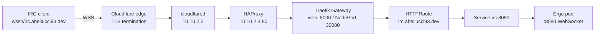

The blog was the first service I exposed from the homelab without opening a single port on my router. IRC is the second.

The DMZ layout, the Cloudflare Tunnel VM, HAProxy, and the Kubernetes cluster are already covered in [the first article](/posts/this-blog-is-overengineered-on-purpose-and-thats-the-point/). This one is about the part that is specific to IRC: making a long-lived, non-HTTP protocol fit through a free Cloudflare Tunnel.

## IRC is not HTTP

IRC wants a persistent TCP connection. The classic ports are `6667` for plaintext and `6697` for TLS. Cloudflare Tunnel can carry those, but not in the way a normal IRC client expects.

On the free plan, a public tunnel hostname is an HTTP/HTTPS endpoint. WebSocket traffic works because it starts as an HTTP upgrade. Raw TCP to something like `irc.abellucci93.dev:6697` would need Cloudflare Spectrum, which is a paid product, or a client-side `cloudflared access` wrapper that regular IRC clients do not speak.

So I did the only sensible thing: I exposed Ergo's WebSocket listener and connected over `wss://`.

Same IRC protocol inside, different transport outside.

## The network path



The important detail is that the IRC hostname uses the HTTP path, not the HTTPS passthrough path used by the blog.

Cloudflare terminates TLS at its edge. The tunnel then forwards plain HTTP to HAProxy on `10.10.2.3:80`, HAProxy sends it to the worker nodes on NodePort `30080`, and Traefik receives it on its `web` entrypoint. From there, a Gateway API listener and an HTTPRoute send the request to the Ergo service on port `8080`.

TLS is not terminated inside the cluster for this service. It does not need to be: the origin leg never leaves the DMZ, and Cloudflare already presented a valid certificate to the client. That also means Ergo does not need a public TLS listener or a certificate of its own.

## Ergo listens on WebSocket only

The relevant part of the Ergo configuration is small:

```yaml
server:
  name: irc.abellucci93.dev
  listeners:
    ":8080":
      websocket: true
      proxy: false
```

Port `8080` is the only listener reachable from the cluster network. The standard `6667` and `6697` listeners are bound to `127.0.0.1` only, so there is no public plaintext IRC port and no direct TLS port.

`proxy: false` is deliberate. The tunnel and HAProxy are not sending the PROXY protocol, so Ergo should not expect it. The tradeoff is that Ergo sees the proxy address rather than the real client IP. That affects bans, connection limits, and throttling, but it is the price of not exposing the origin directly.

## The Kubernetes wiring

Three objects do the actual routing.

The Service gives the pod a stable name and port inside the cluster:

```yaml
service:
  type: ClusterIP
  port: 8080
```

The Gateway declares the listener that Traefik should expose:

```yaml
gateway:
  gatewayClassName: traefik
  listeners:
    - name: web
      protocol: HTTP
      port: 8000
      hostname: irc.abellucci93.dev
```

And the HTTPRoute attaches the hostname and path to the Service:

```yaml
httpRoute:
  routes:
    - parentRefs:
        - name: irc
          sectionName: web
      hostnames:
        - irc.abellucci93.dev
      rules:
        - matches:
            - path:
                type: PathPrefix
                value: /
          backendRefs:
            - name: irc
              port: 8080
```

The listener is `HTTP`, not `HTTPS`, because Cloudflare already terminated TLS. Port `8000` is Traefik's `web` entrypoint; NodePort `30080` is how HAProxy reaches it from outside the cluster. The HTTPRoute only has to match the hostname and send everything to `irc:8080`.

The Gateway and HTTPRoute live in the same namespace, which is why the listener allows routes from `Same`. ArgoCD applies the chart from `clusters/dmz/apps/default/irc` into the `irc` namespace, with the Gateway created before the HTTPRoute.

## The Cloudflare side

The tunnel's public hostname points at HAProxy's HTTP frontend:

```text
irc.abellucci93.dev  ->  http://10.10.2.3:80
```

Cloudflare upgrades the client connection to WebSocket and forwards it through the tunnel. No inbound ports are opened on the router, and no public IP is exposed.

WebSockets are supported on the free plan. Cloudflare closes idle WebSocket connections after about 100 seconds, but Ergo sends a PING every 30 seconds, so the connection stays active. That is one of those details that is invisible until it is not: without the server-side keepalive, the client would reconnect every couple of minutes and history playback would look broken.

## Connecting

The connection URL is the whole trick:

```text
wss://irc.abellucci93.dev
```

No port, no `6697`, no separate TLS setting. Use any IRC client that supports WebSocket URLs.

Account registration works as usual:

```text
/nick andrea
/msg NickServ REGISTER <password>
```

On later connections, either configure SASL in the client or identify manually:

```text
/msg NickServ IDENTIFY andrea <password>
```

Nickname and account name are kept identical, which keeps the nickname reservation rules simple.

## What I would keep in mind

- **Real client IPs are hidden.** Cloudflare and HAProxy sit in front of Ergo, and PROXY protocol is not in use. Bans and rate limits apply to the proxy address, not the user.
- **WebSocket is not optional here.** A client that only understands raw IRC on `6697` cannot connect through this path on the free plan.
- **TLS ends at Cloudflare.** The DMZ leg is HTTP by design. If you switch the tunnel origin to HTTPS, you need to move the Gateway listener to Traefik's `websecure` entrypoint and manage certificates inside the cluster.
- **One Ergo replica keeps routing simple.** There is no WebSocket session affinity to worry about. If the server were scaled horizontally, the load balancer would need sticky sessions or a shared state layer.
- **Keep the PING interval below Cloudflare's idle timeout.** Ergo's default is already fine; changing it without thinking is how long-lived connections start dropping.

IRC behind a free Cloudflare Tunnel is mostly a transport problem. Once the WebSocket listener exists, the Kubernetes side is ordinary Gateway API routing: Service, listener, HTTPRoute, done. The router stays closed, the DMZ stays private, and the IRC network is just another hostname behind the same tunnel.
